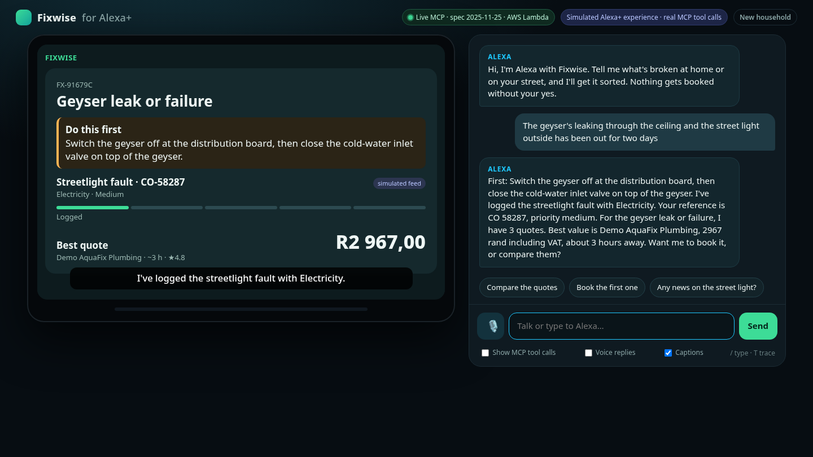

# Fixwise for Alexa+

> "Alexa, the geyser's leaking and the street's been dark for two days."

Fixwise is a self-hosted **MCP server (spec 2025-11-25, Streamable HTTP)** that Alexa+ calls as an add-on. From one spoken complaint it does four things:

1. **Safety first.** It reads out shut-off steps and emergency numbers before anything else.
2. **Municipal case.** It logs the street-side fault with the municipality and gives you a reference. Duplicate reports are linked to the existing case. (The CivicOps catalogue and rules are real; the status feed is simulated and labelled as such.)
3. **Priced quotes.** It prices the private repair from local suppliers in rand, VAT included. Suspended suppliers are excluded, and your budget limit and the suppliers you want to avoid are applied.
4. **Confirmed booking.** It holds the exact quote and books **only after you say yes**. The confirmation is bound to that quote, works once and expires after 15 minutes.

It also remembers your household across sessions. "Any news on the geyser?" works days later, and so does "where's our stopcock?". A tamper-evident audit chain records every action.

On Echo Show, the tools link to **MCP Apps** cards: the issue timeline, a quote carousel and the booking confirmation. In the background, **Amazon Nova Lite** (Bedrock Converse, called from an SQS worker Lambda) writes a short advisor note, so the MCP tools stay deterministic and well under Alexa+'s 500 ms budget. In the simulated Alexa+ console, Nova Lite also **plans each turn with tool use**, and an MCP client calls the live `/mcp` over HTTP (see below).



**Simulated Alexa+ console:** `/console` is an Echo Show-style screen with voice in and out. It renders the same MCP Apps cards and shows a live trace of the real MCP tool calls behind each turn.


## Run locally (Node 20.10+)

```bash
npm ci
mkdir -p .local && node scripts/client-secret.mjs .local/client_secret > .local/hash   # secret stays in a 0600 file
cat > .dev.vars <<EOV
DEV_LOGIN=1
ENVIRONMENT=development
FIXWISE_CLIENTS=[{"client_id":"alexa-local","client_name":"Alexa (local)","redirect_uris":["https://layla.amazon.com/api/skill/link/LOCAL"],"token_endpoint_auth_method":"client_secret_basic","secret_hash":"$(cat .local/hash)"}]
EOV
npm start                                  # http://127.0.0.1:8787/mcp
CLIENT_ID=alexa-local CLIENT_SECRET=$(cat .local/client_secret) REDIRECT_URI=https://layla.amazon.com/api/skill/link/LOCAL npm run e2e
npm test                                   # unit + integration tests (node --test)
```

`npm run e2e` performs Alexa-style account linking: discovery, then PKCE S256 with `resource`, then the token step. It then runs the whole demo story through the **official MCP TypeScript SDK client** and prints per-call latency.

## Simulated Alexa+ console: how a turn works

1. **Plan.** Nova Lite (Bedrock Converse, tool use) gets the utterance, a short dialogue history and the server's own `tools/list` (cached for 5 min). It returns one or more tool calls. (`src/console/planner.js`)
2. **Guard (in code).**
   - A yes or no to a held booking never reaches the model.
   - The model can't see or set `approval_id` or `confirm`.
   - A booking, cancel or close the user didn't ask for drops the whole plan.
   - Duplicate reports are merged.
   - A missed "remember" is added back.
3. **Act.** `McpHttpClient` (`src/console/mcp-client.js`) calls `POST /mcp` on the public origin with a short-lived bearer token for the demo household, the same way Alexa+ would. It initializes once per conversation.
4. **Fallbacks.** If Bedrock errors or takes longer than 3.5 s, the regex router (`src/console/intents.js`) takes over. If the HTTP hop fails, the same handler runs in process. The trace shows which path ran.
5. **Show.** Speech, captions and the MCP Apps card, plus an on-screen trace: the planner and its ms, Nova tokens, and each `tools/call` with its args, ms and transport.

**New conversation** keeps the household and drops the dialogue, so you can show memory across sessions ("any news on my geyser?").

## By the numbers (live, 22 Oct 2026)

| | |
|---|---|
| Tool call round trip, Johannesburg → Cloudflare → Lambda (`judge.mjs`) | p50 150–170 ms, max 259 ms (three runs) |
| Lambda server side per tool call (CloudWatch) | p50 10 ms, p90 55 ms |
| Console turn: Nova Lite planning / whole turn (server) | p50 ≈ 650 ms / ≈ 0.75–1.2 s |
| Nova Lite tokens per planned turn | ≈ 2,050 in / 60 out |
| Model cost per 8-turn conversation | ≈ $0.001 |
| Tests | 58 Node (`npm test`) + 3 Python (`pytest agents`) |
| Lighthouse accessibility (`/console`) | 100 desktop, 100 at 412 px, 100 at 375 px |

## Judges: connect your own MCP client in one command

```bash
curl -fsSL https://alexa.culltron.app/judge.mjs -o judge.mjs && node judge.mjs          # Node 18+, zero dependencies
EMAIL=judges@culltron.app PASSCODE=... node judge.mjs                                    # headless sign-in
node judge.mjs --interactive                                                             # call any tool yourself
```

The script works through these steps:
1. Checks both 401 rules: `/mcp` sends `WWW-Authenticate` (MCP spec), `/alexa/mcp` doesn't (Alexa+).
2. Reads both OAuth discovery documents.
3. Runs **OAuth 2.1 + PKCE S256 + `resource`** with the public client `fixwise-judge`, which has a localhost redirect and no secret.
4. Runs `initialize` (2025-11-25), `tools/list` and `resources/list`.
5. Plays the demo story as real `tools/call`s and prints the latencies.

The output from a production run is in [`docs/submission/evidence-judge-run.txt`](docs/submission/evidence-judge-run.txt).

**MCP Inspector:** `TOKEN_FILE=tok node judge.mjs`, then `npx @modelcontextprotocol/inspector --cli https://alexa.culltron.app/mcp --transport http --header "Authorization: Bearer $(cat tok)" --method tools/list`. The transcript is in [`docs/submission/evidence-mcp-inspector.txt`](docs/submission/evidence-mcp-inspector.txt). In the Inspector UI, use client ID `fixwise-judge` with redirect `http://localhost:6274/oauth/callback`.

**401 / OAuth evidence (live):**

```
$ curl -si -X POST https://alexa.culltron.app/mcp -H 'content-type: application/json' -d '{"jsonrpc":"2.0","id":1,"method":"ping"}'
HTTP/2 401
content-type: application/json
www-authenticate: Bearer resource_metadata="https://alexa.culltron.app/.well-known/oauth-protected-resource"   <- MCP spec
$ curl -si -X POST https://alexa.culltron.app/alexa/mcp ...
HTTP/2 401                                                        <- no WWW-Authenticate (Alexa+ rule)
$ curl -s https://alexa.culltron.app/.well-known/oauth-protected-resource
{"resource":"https://alexa.culltron.app/mcp","authorization_servers":["https://alexa.culltron.app"],"scopes_supported":["fixwise.read","fixwise.act"],...}
```

The full transcript is in [`docs/submission/evidence-oauth-401.txt`](docs/submission/evidence-oauth-401.txt).

## Tools

| Tool | What it does |
|---|---|
| `fixwise_report_problem` | Safety steps, municipal case (asks for the suburb if missing), quotes; splits compound reports into separate repairs; queues the advisor note |
| `fixwise_check_status` / `fixwise_list_issues` | Progress on your issues, across sessions |
| `fixwise_compare_quotes` | Quote carousel |
| `fixwise_book_repair` | Two steps: hold the quote, then confirm only after a yes |
| `fixwise_cancel_booking` / `fixwise_close_issue` | Change or finish an issue |
| `fixwise_remember` / `fixwise_recall` | Budget limit, visit times, suburb, suppliers to avoid, notes |
| `fixwise_activity` | Audit trail with chain verification |
| `fixwise_disconnect` | Revoke the Alexa link |

## Alexa+ compliance

- Streamable HTTP POST `/mcp`, protocol `2025-11-25`. The `MCP-Protocol-Version` header is checked and Origin is validated.
- Unauthenticated calls get 401: with `WWW-Authenticate` + `resource_metadata` on `/mcp` (MCP spec), and with **no** header on `/alexa/mcp` (the Alexa+ endpoint). The PRM document (RFC 9728) and AS metadata (RFC 8414) are published, and `S256` is advertised.
- OAuth 2.1 authorization code with PKCE and the `resource` parameter (RFC 8707). Clients are static and pre-registered, with no DCR and no OIDC. Refresh tokens rotate, and reuse is detected. Tokens are stored only as hashes.
- Measured live (22 Oct 2026): tool-call round trip from Johannesburg via Cloudflare p50 150–170 ms, max 259 ms (three runs); Lambda server side p50 10 ms. The Lambda is kept warm, and slow work is moved off the voice path.

## Live

- MCP: `https://alexa.culltron.app/mcp` (spec 401) · Alexa+ skill endpoint: `https://alexa.culltron.app/alexa/mcp`
- Simulated Alexa+ console: https://alexa.culltron.app/console
- Hosting: `alexa.culltron.app` is a Cloudflare Worker (`fixwise-alexa-proxy`) passing every request, streams included, straight to the arm64 Lambda Function URL in us-east-1. `PUBLIC_ORIGIN=https://alexa.culltron.app` keeps the OAuth issuer, `resource` and discovery metadata on the custom domain.
- Lambda latency (CloudWatch): p50 10 ms, p90 55 ms, max 138 ms

## AWS (AWS Builder mini challenge)

- **Lambda Function URL → Lambda** (Node 22, arm64) runs the MCP and OAuth server.
- **DynamoDB** (on demand, with TTL) holds the household state.
- **SQS → advisor Lambda → Amazon Bedrock (Nova Lite, Converse)** writes the advisor note to its own DynamoDB key, so it can never overwrite a booking made meanwhile. A Strands agent for **AgentCore Runtime** is in `agents/fixwise_agent` and in the CDK stack behind `agentImageUri`, but it is **not deployed** (no container step; production calls Bedrock directly).
- **Console planner:** the MCP Lambda calls Nova Lite (`us.amazon.nova-lite-v1:0`) with Converse tool use. Its IAM policy is scoped to `amazon.nova-*` models.
- **EventBridge** sends keep-warm pings.
- **CloudWatch** alarms cover errors, p95 latency and the DLQ. The account-wide **AWS Budget** `fixwise-monthly` ($50) alerts at $20 and $50 actual, and $50 forecast.
- Secrets are kept in an **SSM SecureString**; passcodes and client secrets are stored only as hashes.
- The Lambda Function URL is **origin-locked**: it answers 403 unless the request carries the Cloudflare Worker's secret header, so Cloudflare's per-IP rate limit on `/console/api/*` can't be bypassed.
- The console issues **HMAC-signed session ids** (clients can't invent households), limits each IP and session per minute before any model call, and caps Nova calls per hour globally (above it, the regex router answers).
- Passcode sign-in locks out after 5 tries per link, 10 per email and 30 per IP per 15 minutes.
- Strict CSP: no inline script on the console; each card's script is allowed only by its SHA-256 hash. Cards pin `postMessage` to their parent and ignore other senders.
- The advisor role can invoke **Nova models only**.

```bash
BUDGET_EMAIL=you@example.com ./scripts/deploy.sh   # identity, Bedrock check, SSM secrets (hashes), build, CDK deploy, smoke test
```

## Responsible design

- Fixwise never replaces 112, 10177 or 10111.
- Nothing is booked without an explicit yes.
- Fixwise takes no card details; repairs are paid on completion.
- Suppliers and the municipal feed are synthetic in this demo, and are labelled so.

See [PROVENANCE.md](PROVENANCE.md) for the code reused from earlier Culltron projects.

## License

Apache-2.0. The CivicOps-derived parts are MIT (`vendor/civicops/LICENSE`).
