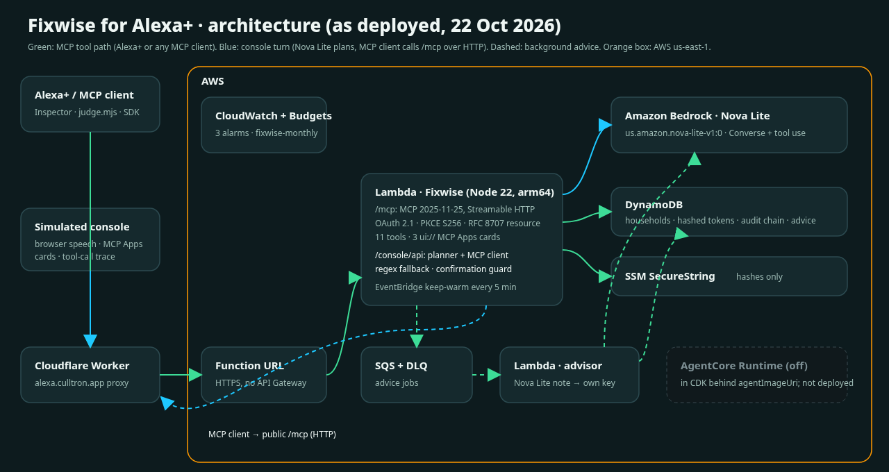

# Fixwise: tell Alexa what's broken, and it gets fixed

**Track:** Alexa+ · **Mini challenge:** AWS Builder · **Live:** https://alexa.culltron.app/console · **MCP endpoint:** `https://alexa.culltron.app/mcp` (Alexa+: `/alexa/mcp`) · **Code:** https://github.com/AeriesAgi/fixwise

## Inspiration
When a geyser bursts or the street goes dark, a household juggles three jobs at once: what to do *right now*, getting the municipality to fix the public part, and finding a plumber they can trust for the private part. Each is a separate call, app or website, and it usually happens with wet hands in the kitchen. Voice is the natural interface for that moment. Fixwise turns one sentence into all three jobs, and nothing gets booked without a yes.

## What it does
Say one sentence to Alexa+, for example *"The fridge is buzzing and the kitchen tap drips, and the street light outside has been out for two days."* Fixwise:
1. **Puts safety first.** Shut-off steps come first, plus emergency numbers when someone may be in danger. It never replaces 112, 10177 or 10111.
2. **Handles compound problems.** One sentence with several faults becomes separate repairs, each with its own quotes. A geyser leaking through the ceiling is treated as one job, the geyser, because it's the root cause.
3. **Logs the public part with the municipality** and reads back a reference. If you didn't say where it is, it asks for the suburb or street and adds your answer to the case. A repeat report of the same fault is linked to the existing case.
4. **Prices the private repair** in rand, VAT included. Quotes are ranked by urgency, price and rating. Suspended suppliers are left out, and your budget limit and blocked suppliers are respected.
5. **Books only after you say yes.** The hold is tied to that exact quote, works once and expires after 15 minutes. The language model can't confirm a booking. Only code can, after a clear yes.
6. **Remembers your household across conversations.** *"Any news on my geyser?"* works in a new conversation days later, and so does *"where's our stopcock?"*. A background advisor note (Nova Lite) is added once it's ready.
7. **Shows its work.** MCP Apps cards show the timeline, the quote carousel and the confirmation. Every action goes into a hash-chained audit trail that you can verify by voice ("what have you done for me?").
8. **Reads a photo.** Send a picture of the fault; Nova Lite identifies it and the same safety → municipal → quotes flow runs.
9. **Tracks the job to done.** A tracker card runs from reported to fixed. When the (simulated) municipal case is overdue it offers escalation, which is **recorded, not sent**.
10. **Books a realistic visit.** Trades work 07:00–17:00 Mon–Sat; urgent jobs are same-day only if they can start by 15:00. You get a signed **.ics file** (not an Alexa reminder), a **parts list** as amazon.co.za search links (nothing ordered) and, for electrical jobs, a **generic load-shedding tip** (not live schedule data).
11. **Explains the price.** *"Why is the first one more expensive?"* gets the gap and its main cause spoken, plus a line-by-line table.
12. **Asks how it went.** After the visit, *"any news?"* asks for 1–5 stars. A low score means that supplier is never suggested again; "not fixed" reopens the job with the other quotes.
13. **Speaks Afrikaans and isiZulu (console).** Nova Lite translates both ways. Polly has no voice for either, so replies use the device voice or captions; cards stay English; isiZulu is beta.
14. **Shares with the landlord.** A signed, read-only, 7-day live page. Fixwise never sends it; the tenant does.
15. **Says no politely.** Requests outside home and street repairs (weather, music) get a short, friendly refusal and a prompt to say what needs fixing.

## How we built it

- **A self-hosted MCP server: spec 2025-11-25 over Streamable HTTP, with zero runtime dependencies.** It has 11 annotated tools (read-only, destructive and open-world hints), with descriptions written for Alexa+ reasoning, and 3 `ui://` MCP Apps resources. It validates the protocol-version and Origin headers. (`src/mcp/`)
- **OAuth 2.1 account linking built to Alexa+'s rules.**
  - An unauthenticated call gets **401 with no `WWW-Authenticate`**.
  - Discovery documents follow RFC 9728 and RFC 8414.
  - PKCE S256 is used, and the RFC 8707 `resource` is bound at both steps.
  - Clients are pre-registered: no DCR and no OIDC.
  - Refresh tokens rotate, and reuse is detected.
  - Tokens are stored only as hashes. (`src/oauth/oauth.js`)
- **Simulated Alexa+ console, our submitted surface (the rules' simulated path).** Each turn works like this:
  1. **Amazon Nova Lite** (`us.amazon.nova-lite-v1:0`, Bedrock Converse with tool use) reads the utterance plus the server's live `tools/list`, then picks one or more tools and their arguments.
  2. An **MCP client** calls the public `/mcp` endpoint over HTTP with a short-lived bearer token for that demo household, the same way any MCP host does.
  3. The speech, the MCP Apps card and an **on-screen trace** come back: the planner and its latency, Nova token counts, and every `tools/call` with its arguments, timing and transport.

  The console has three safeguards:
  - **Confirmation guard.** A yes or no to a held booking is decided in code, never by the model.
  - **Intent guard.** If the model proposes a booking, a cancel or a close that the user never asked for, the plan is discarded.
  - **Regex fallback.** If Bedrock errors or takes longer than 3.5 s, a deterministic router takes over.

  (`src/console/planner.js`, `api.js`, `mcp-client.js`)
- **Background advice.** `fixwise_report_problem` queues a job on SQS. A worker Lambda asks Nova Lite (Converse) for a two-sentence advisor note and writes it to its own DynamoDB key. The next read of the household folds the note in, so a late note can never overwrite a booking made in the meantime. The Strands agent and the AgentCore Runtime are in the repo (`agents/`, and the CDK stack behind the `agentImageUri` flag) but are **not deployed**. The live advisor calls Bedrock directly from Lambda.
- **Hosting.** `alexa.culltron.app` runs through a Cloudflare Worker, then a Lambda Function URL, then the Lambda (Node 22, arm64, kept warm by EventBridge). State lives in DynamoDB (on demand, with TTL), secrets in an SSM SecureString (hashes only), and there are CloudWatch alarms and an AWS Budget. All of it is CDK in Python, deployed with one command (`scripts/deploy.sh`).
- **Reused** (see PROVENANCE.md): the CivicOps (MIT) municipal catalogue, classifier and audit chain, ported to JavaScript. Everything else was written for Fixwise.

## By the numbers (measured 22 Oct 2026, live, us-east-1)
| | |
|---|---|
| MCP tool call, round trip from Johannesburg via Cloudflare (judge client) | **p50 150–170 ms, max 259 ms (three runs)** (Alexa+ budget: 500 ms) |
| MCP tool call, Lambda server side (CloudWatch) | p50 10 ms, p90 55 ms |
| Console turn, Nova Lite planning | **p50 ≈ 650 ms**; whole turn ≈ 0.75–1.2 s server side |
| Nova Lite tokens per planned turn | ≈ 2,050 in / 60 out |
| Model cost per 8-turn conversation | **≈ $0.001** (Nova Lite on-demand $0.06 / $0.24 per M tokens) |
| Tests | **50 Node tests + 3 Python tests**, all passing; gitleaks clean |
| Accessibility | **Lighthouse 100** on desktop, 412 px and 375 px |
| Tools / MCP Apps cards | 11 / 3 |

## Testing instructions (for judges)
1. **No install: the console.** Open **https://alexa.culltron.app/console**. Each browser gets its own synthetic household. Type or speak (Chrome or Edge):
   1. *"The fridge is buzzing and the kitchen tap drips"*
   2. *"The street light outside has been out for two days"*, then answer the suburb question
   3. *"Remember our budget is 2000 rand and compare the quotes for the fridge"*
   4. *"Book the first one for the fridge"*
   5. **Yes, book it**
   6. **New conversation**, then *"Any news on my fridge?"*
   7. *"Why is the first one more expensive?"* (cost table)
   8. Press **⏩ +48 h** twice, then *"Any news?"* and answer *"Not fixed, 2 stars"* (rating)
   9. *"Share this with my landlord"*, then open the link (read-only page)
   10. Switch the language to **Afrikaans** and say *"My kombuiskraan lek"*

   The tool-call trace is on by default; press **T** to hide it.
2. **One command: your own MCP client.**
   `curl -fsSL https://alexa.culltron.app/judge.mjs -o judge.mjs && node judge.mjs` (Node 18+, no dependencies).
   It checks the 401 rule and OAuth discovery, then runs PKCE account linking in your browser. Sign in as **judges@culltron.app** with the passcode from the private testing field. After that it runs `initialize`, `tools/list`, `resources/list` and the demo story with latencies.
   Run `node judge.mjs --interactive` to call any tool yourself.
3. **MCP Inspector.** Use the public client `fixwise-judge` (PKCE, no secret; redirect `http://localhost:6274/oauth/callback`) with server URL `https://alexa.culltron.app/mcp`. Or get a token with `TOKEN_FILE=tok node judge.mjs`, then run `npx @modelcontextprotocol/inspector --cli https://alexa.culltron.app/mcp --transport http --header "Authorization: Bearer $(cat tok)" --method tools/list`. Our transcript is in `docs/submission/evidence-mcp-inspector.txt`.
4. Suppliers, prices and municipal progress are synthetic, and bookings are simulated. No card details are ever taken.

## AWS services used (AWS Builder)
| Service | How Fixwise uses it |
|---|---|
| Amazon Bedrock: Nova Lite | Plans each console turn with Converse tool use over the MCP tool catalogue, and writes the background advisor notes. |
| AWS Lambda (Node 22, arm64) + Function URL | The MCP, OAuth and console server, plus the SQS advisor worker. Public HTTPS without API Gateway. |
| Amazon DynamoDB | Household state, hashed tokens, the audit chain and advisor notes (on demand, with TTL). |
| Amazon SQS + DLQ | Keeps advisor work off the voice path. |
| Amazon EventBridge | Keep-warm ping every 5 minutes. |
| AWS Systems Manager Parameter Store | A SecureString holding client and household hashes only. |
| Amazon CloudWatch + AWS Budgets | Alarms on errors, p95 latency and DLQ depth; the `fixwise-monthly` budget alerts. |
| AWS CDK (Python) | All the infrastructure as code. |

## Challenges
- **Alexa+ OAuth differs from generic MCP OAuth.** Alexa+ wants no `WWW-Authenticate` on 401, no DCR and no OIDC. So the server has two mounts on one OAuth server: `/mcp` follows the MCP spec (401 with `WWW-Authenticate: Bearer resource_metadata=…`), and `/alexa/mcp` follows the Alexa+ rule (no header). A token works on both.
- **Letting a model drive tools without letting it spend money.** The model never sees the confirmation fields, and code alone redeems a held quote.
- **A lost-update race.** The background advisor used to rewrite the household record, and a booking made in the meantime could vanish. We found it with the judge client and fixed it by giving advice its own key. There is a regression test for it.
- **Partner-only Alexa+ tooling.** The CLI, MCP Toolkit and Web Simulator are gated, so we built a faithful simulated host and an open judge client instead. See the friction log.

## Accomplishments
- ✅ A real model-driven agent, Nova Lite with tool use, calling a real MCP server over HTTP, shown live on screen
- ✅ Alexa+-compliant OAuth 2.1, proven live (`docs/submission/evidence-oauth-401.txt`)
- ✅ One-command judge client and an MCP Inspector transcript against production
- ✅ Compound problems, follow-up questions for missing locations, polite out-of-scope replies, and memory across conversations
- ✅ Purchases that are safe by construction: a two-step, digest-bound, single-use hold that only code can confirm
- ✅ Lighthouse accessibility 100, a 375 px layout, live captions, ARIA live regions and reduced-motion support
- ✅ Zero spend beyond credits: Nova only, no API Gateway, no NAT, and a budget alarm

## What we learned
Put guardrails in code, not in prompts. Nova Lite plans well, but it sometimes splits one report into two calls, or drops half of a two-part request. Small deterministic passes after planning (merge reports, add a missed "remember", reject actions the user never asked for) fixed this without a bigger model. Alexa+'s 500 ms budget also pushed us to keep every MCP tool deterministic and fast, and to use the model only for planning and for advice that can arrive later.

## What's next
- A CivicOps municipal pilot to replace the simulated feed with real work-order status.
- Real supplier onboarding with verified, insured local trades.
- A follow-up beat by SMS or email when the municipal case moves.
- Insurance claim packs built from the audit chain.
- Native Afrikaans and isiZulu voices once a TTS voice exists for them, and translated cards.
- Live load-shedding data from a source licensed for commercial use.
- On-device Alexa+ testing as soon as the developer tools open up.

## Product feedback (per tool)
**Alexa+ MCP Toolkit / Alexa AI CLI.**
- Planned use: onboarding and account linking.
- Worked well: the docs state the exact OAuth requirements (no WWW-Authenticate, S256, `resource`).
- Needs work: the CLI is partner-only, but the setup page doesn't say so. The role assumption fails with a bare AccessDenied, and a lookalike `alexa-ai` package sits on public npm (friction log items 7–9).
- Build again: yes, once access opens.

**MCP specification 2025-11-25, official TypeScript SDK and MCP Inspector.**
- Worked well: the SDK and Inspector CLI talked to our zero-dependency server first time.
- Needs work: the spec's MUST on `WWW-Authenticate` conflicts with Alexa+'s rule. Inspector 2.x needs Node ≥ 22.19, which isn't stated in its README quick start (friction log item 10).
- Build again: yes.

**MCP Apps (`ui://` resources).**
- Worked well: one HTML file per card renders in any host.
- Needs work: there's no reference Alexa host or viewport table for local testing.
- Build again: yes.

**Amazon Bedrock: Nova Lite (Converse with tool use).**
- Used for: turn planning and advisor notes.
- Worked well: planning takes about 650 ms with temperature 0, and tool-use JSON was valid in every one of our runs.
- Needs work: on a new account, Bedrock returned "account is being verified" for about an hour, with no console indicator. Nova sometimes splits a single report or drops one half of a two-part request (friction log items 5 and 11).
- Build again: yes.

**Amazon Bedrock AgentCore + Strands.**
- Planned use: hosting the advisor agent.
- Needs work: container-only deploys add a Docker step for small agents, so production calls Bedrock directly. The runtime stays in CDK behind one flag.
- Build again: yes, for heavier agents.

**AWS CDK, Lambda, DynamoDB, SQS, Parameter Store.**
- Worked well: a full redeploy takes about 1 minute.
- Needs work: a new account's Lambda concurrency limit of 10 makes any reserved concurrency fail the deploy, with an error that doesn't name the quota (friction log item 6).
- Build again: yes.

## Built with
`mcp` `alexa-plus` `amazon-nova` `amazon-bedrock` `aws-lambda` `dynamodb` `sqs` `aws-cdk` `cloudflare-workers` `node.js` `oauth2` `mcp-apps`
